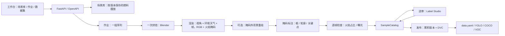
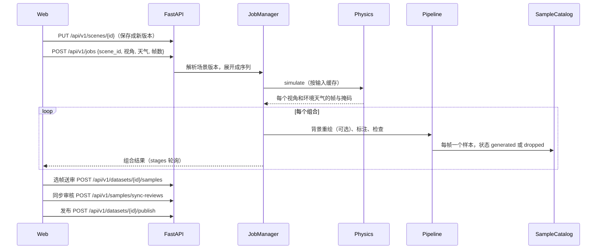
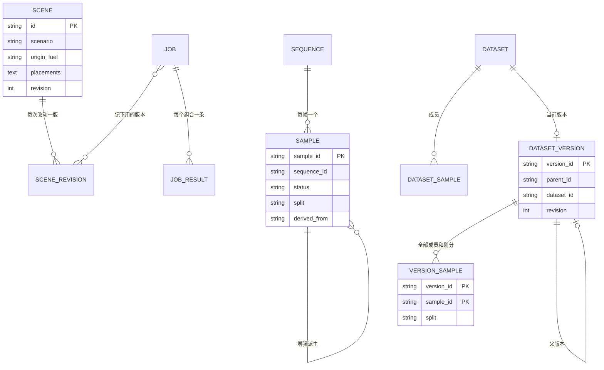

# 软件设计文档

## 架构

## 生成时序（UML）

## 数据模型（ER）

## 生成

作业的每一行是一个序列，也就是一次烘焙：基础场景、燃料摆放、物理参数和种子。行里带 `scene_id` 时，服务端把场景的当前版本（或指定的 `scene_revision`）展开进作业，以后再改场景不影响这次作业。`count` 重复烘焙，每次换种子；种子会微调起火点和进气速度，所以每次是不同的一团火。

物理仿真只用 Blender。脚本在火源周围烘焙一块 Mantaflow 气体域，用黑体体积着色。烘焙只做一次，然后对每一帧、每种环境天气、每台相机各渲染一张 256 PNG，同时用合成节点把发光通道写成掩码。只有火焰体积发光，所以掩码就是火焰，不受背景颜色影响。每个视角在场景里找一台看得见火焰的相机：侧视平视，俯视从高处往下，第一人称在 1.6 m 眼高。场景太窄放不下某个视角时借用侧视机位，并在结果里标明。场景可以改写起火点、这三台相机的位置、目标和焦距，以及气体域的中心、边长和分辨率（16–128 格）；没改写时仍用自动机位和自动气体域。自动气体域每边不超过 4 m；自定义的盒子可以铺满场景，改由算力预算限制：`physics/simulation.py` 按格数、模拟帧数、噪声倍数和渲染张数估算 Blender 时间，超过 30 分钟的作业在提交时拒绝，Blender 超时按估算放宽。场景还可以改模拟设置（`simulation`）：预热时长、噪声细节、涡度、燃烧速度、火焰温度、烟量和 Cycles 采样；全是默认值时存为空，旧场景的缓存和序列编号不变。环境（室内暗环境、室外天空）和天气（晴、雨、雪的天光和降水粒子）都在 Blender 里切换，不重新烘焙。

温度、烟和速度网格来自参数化羽流，点云用这套场。Blender 没产出画面时，回退画面是温度场投影，掩码取投影温度高于 175 °C 的像素，环境和天气用 2D 着色。作业和样本里写明退回的后端。

渲染结果按全部输入缓存在 `build/engine-cache/<key>/`，只重跑一个组合不会重新烘焙。

Stable Diffusion 不在生成路径里。审核之后，`synthesis.sd_augment` 对数据集里已审核的原始样本逐帧调 img2img，带上掩码（该帧火焰掩码外扩 9 像素再取反），只改背景，火焰区域始终是渲染原片；SSIM 低于 0.35 或调用失败时不存样本。派生样本直接是已审核，复制审核过的框，`derived_from` 指向原样本，沿用原样本的序列和划分。任务由 `augment_jobs.AugmentJobs` 在后台跑。

天气是物理输入：每种天气一次烘焙。雨把入流温度和燃料降到 0.75 和 0.7，燃烧速度降到 0.8，烟量升到 1.6 倍并变成浅灰的水汽色，再加一股向下的风；雪的变化小一些。雨雪是 Newton 粒子，受重力、阻尼和同一个风场驱动，在火和相机上方的空间里生成。环境温度按 293.15 / T 调整浮力，湿度降低入流温度和烟量，和参数化羽流一致。

## 样本、标注和检查

每一帧是一个样本：`samples/<id>/` 下有 `image.png`、`mask.png`、`annotation.json`、`label_studio.json`、`quality_report.json` 和 `provenance.json`。视频（每个组合一段）、物理场、点云和 Blender 脚本只在 `sequences/<sequence_id>/` 存一份。样本 ID 由场景参数（含摆放、场景版本、视角、帧号）、种子、生成器版本和后端身份算出。

标注取掩码的连通区域，相距几像素的火舌先合并，一块火焰一个对象，带框、轮廓多边形和底部、中心、顶部三个关键点。类别表固定为 flame、smoke、ember，编号 0、1、2，导出、训练和评估共用。

逐帧检查：火焰占比低于 `min_flame_area`、背景几乎全黑或大面积过曝的帧标为 `dropped`，不能加入数据集；火焰被画面边缘截断只做标记。FID 和 IS 描述一组图像相对参考集的分布，所以在发布时对整个版本计算。

## 审核和版本

人在结果抽屉里选帧，送到当前数据集；送出前先逐个检查，任何一个不合格就都不送。送到 Label Studio 的任务用样本文件地址加载图片。审核同步分页拉取全部任务，取每个任务最新的一条标注：提交记为 `reviewed`，跳过记为 `rejected`，框、关键点和属性都回写。只有 `pending_review` 的样本能被审核；已审核的样本可以重审，但进入任何已发布版本后就冻结。

版本是累积的：成员 = 父版本（数据集当前版本）里仍然有效的样本 + 数据集里从未进过任何版本的新审核样本。没有变化时不发布。每个样本第一次发布时按序列 ID 的哈希分到 train/val/test（80/10/10），以后不变，同一段序列的帧不会跨划分。发布包包含 `data.yaml`、`images/<split>/`、`labels/<split>/`、每个划分的 COCO、VOC、清单、统计和质量报告，`DatasetStore` 对它做 `dvc add`。未加密时图像以硬链接进入工作区和快照；样本文件总是先写临时文件再替换，已发布的图像不会被重写。回滚是把某个版本设为数据集当前版本，下次发布以它为基础。版本对比给出统计差异和样本级的新增、移除、换划分。

作业逐组合结果保存在 PostgreSQL `job_results` 表，场景、场景版本、样本、数据集和版本目录也在同一个库。图片、视频、点云和 DVC 内容寻址缓存在磁盘上。`DATASET_ENCRYPTION_KEY` 设置后，工作区和快照使用 Fernet 认证加密。账号也在同一个 PostgreSQL 库：人只登录工作台，打开 Label Studio 时由服务端签发已登录会话。

## 内部接口

`jobs.JobManager -> runs.execute -> pipeline.run_sequence -> physics.engine.simulate -> annotation.annotate -> quality.filter.sample_checks -> versioning.samples.SampleCatalog` 是生成路径。`scenes.resolve_scene_items` 在提交时固定场景版本。`versioning.publish.publish_dataset` 在人工审核之后写入 `DatasetStore`。OpenAPI 由 FastAPI 自动生成。
